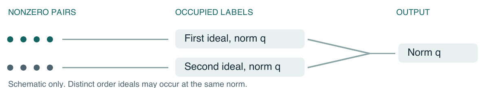
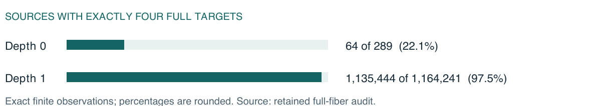

# Quadratic image compression

Technical research report · Evidence snapshot of 5 November 2026

## Conclusions and notation

**Proved.** A single squared integer linear form plus an integer linear term admits same-set power saving. For the full-rank Eisenstein form, the evidence establishes exact return geometry, an exponential supply of integral actions, and a reduction to occupied arithmetic labels. It establishes a quadratic-size image for several specified test families. **Open.** No fixed positive compression exponent for the full-rank target follows.

For a fixed real polynomial $P$, the target is: there exists $\epsilon_P>0$ such that, for every $N_0$, some finite $A\subset\mathbb{R}$ has $|A|\ge N_0$ and $|P(A,A)|\le |A|^{2-\epsilon_P}$. Count the complete set of values of all ordered pairs. An output fiber is the set of all pairs with one value. An action orbit can be strictly smaller.

### Notation used throughout

**$n,d,j$.** Cardinality of an actual scalar set, initial tower-field degree, and tower index. The balanced-factor depth is denoted $r$ instead. Fixed constants precede the growing index.

**$Q,\omega,\tau$.** The benchmark is $Q=x^2+xy+y^2$. The primitive cube root $\omega$ satisfies $\omega^2+\omega+1=0$. The relative involution $\tau$ fixes the coefficient field and sends $\omega$ to $\omega^2$.

**$\mathcal{R}_j,U_j,r_j(p)$.** Respectively the coefficient order, the finite inventory of integral norm-one units, and the number of distinct actual targets reached at a source. The order and the return count use different typefaces and letters here.

**$N_j,\nu_j$.** The number $n_j^2-1$ of nonzero pairs and the number of occupied joint ideal-and-norm labels. Expectations in the report are uniform on these $N_j$ sources.

### Scope of the four tracks

The fixed targets remain distinct: T01 is $(x-y)^3+x+y$; T02 is $(x+2y)^4+3x-y$; T03 is $Q$; T04 is $(x-y)^3-3(x+y)$. All four remain open. The separate affine benchmark $Q+x$ does not replace T01. T03's adaptive radical obligation RC15/4 is independent of the order-unit construction below.

Sources: [Track identities and source hierarchy](../../CURRENT_PROJECT_MAP.md); [T03, current dated status](../../tracks/03-eisenstein-cartesianization/STATUS.md); [Source-indexed claim register](evidence_register.csv)

<!-- page -->

## The C0 theorem and its gain

**Statement (proved, v5 Theorem 1).** Fix any $(a,b,c,e)\in\mathbb{Z}^4$, set $L=ax+by$, $M=cx+ey$, and $P=L^2+M$. Then $P$ satisfies the target on page 1. The quadratic part has rank one if $L$ is nonzero and rank zero otherwise. There is no primitivity or nonvanishing requirement. The September corrected theorem proved a narrower statement; the broader quantifier is explicit in the 3 November theorem. The structural condition $ab(ae-bc)\ne0$ suffices for nonspecialness, a different conclusion.

**Mechanism.** Proposition 3.8 of OpenAI, *Planar Point Sets with Many Unit Distances* (2026), supplies many fixed completely split odd primes in a totally real tower with controlled root discriminant $D$. Let $S$ be the product of those primes and put $P_S=L^2+SM$. At each prime divisor of $S$ the linear term vanishes. When both coefficients of $L$ vanish modulo a prime, only zero occurs; in every case the local image is contained in the squares. Writing $\rho$ for the product of the local densities gives
$$
P_S(Sx,Sy)=S^2P(x,y),\qquad \rho=\prod_{p\mid S}\frac{p+1}{2p}.
$$

Complete splitting gives a container of at most $(\rho S)^d$ residue classes in degree $d$. Let $H_P=(|a|+|b|)^2+|c|+|e|$ and $C_P=2H_P+1$. Fix the tower and primes so that $\theta=C_P D\rho<1$, then fix a radius $X>\max(S,\sqrt D)$. The all-conjugate bound on the deformed output is $H_P X^2$. Distinct elements of one residue class differ by $S$ times a nonzero algebraic integer, so the house bound gives a uniform population bound in every permitted class.

**Consequence.** For the centered algebraic-integer box and its real scalar copy divided by $S$, the proof obtains
$$
(X/\sqrt D)^d\le n\le(2X+1)^d,\qquad |P(A,A)|\le\theta^d n^2 .
$$

The lower bound grows; the upper bound converts the gain to exactly $\epsilon_P=-\log(\theta)/\log(2X+1)>0$ in this ledger. There is no remaining prefactor here. The same construction of a sparse local container does not automatically apply to a rank-two quadratic part: the matrix of $Q$ has determinant $3/4$.

Sources: [C0 v5, Theorem 1, parameter order, input count and full output bound](../../proofs/c0-v5/theorem-and-proof.tex); [Earlier C0.1, corrected September statement](../../proofs/c0-2026-09-03/Phase_C0_Corrected.md); [External result, OpenAI 2026, Proposition 3.8](https://cdn.openai.com/pdf/74c24085-19b0-4534-9c90-465b8e29ad73/unit-distance-proof.pdf)

<!-- page -->

## Norm orbits and the retirement tests

For $z=x-\omega y$, the identity $Q(x,y)=z\tau(z)$ explains why exact norm-preserving actions were attractive. Three different levels of evidence resulted.

**Exponent orbit (proved; selected certificate fails).** The depth-$d$ seed orbit has $3^d$ distinct points with at least $2^d$ returning actions at each one. Its two coordinate projections together have exactly $2\cdot3^d$ distinct scalars. The engineered fraction of the resulting Cartesian square is only $1/(4\cdot3^d)$. This estimate is about certified coverage, not the complete image of that projection.

**Dyadic multiscale packings (proved; two families fail).** Exact doubling-angle identities reuse scalar coordinates. In the original cosine-product packing at least $4(n-1)^2/9$ pairs have full fiber size four. In its mixed-amplitude variant at least $(n-1)^2/2-4(n-1)$ have full fiber size at most 48. Dividing these populations by the corresponding full-fiber bounds proves quadratic image growth for each family. The full-fiber arguments strengthen earlier failures for selected actions.

**Balanced products (proved; BFF-O1).** Put $q=7^r$, let $\xi$ be a primitive $q$th root, and take amplitudes $h\prod_{\ell<r}(2-\xi^{i_\ell 7^\ell})$, for $1\le h\le8$ and digits $-3\le i_\ell\le3$. Rotate by the $6q$th roots of unity and take the same-set coordinate completion via $z=x-\omega y$. Its actual size is between $16q^2+1$ and $24q^2-7$. At the last degree-seven tower layer, 1,344 of 2,401 source types give rank-four maps. A finite algebraic elimination bound and an exceptional zero-set count control all target types. For some fixed $M$ and all sufficiently large $r$, at least $32q^4$ actual sources have at most $M$ full targets. Hence
$$
n^2/(18M)\le |Q(A,A)|\le n^2 .
$$

This is an actual image theorem for the specified family, not a universal impossibility result.

**Finite evidence.** At depths 0 and 1 the complete exact audits gave $(n,|Q(A,A)|)=(17,44)$ and $(1079,286664)$. Pair-weighted median full-fiber sizes were 12 and 4. A second norm-based traversal matched the full multiplicity distributions. These two sizes suggested the obstruction; the later all-depth proof establishes it.

Sources: [UE-P2–P3, orbit coverage](../../notes/2026-09-16-unit-exponent/primary-proof.md); [XB-F1–F2, both full-fiber bounds](../../notes/2026-10-06-cross-block-returns/README.md); [BFF-O1, §§1–4 and proof companions](../../notes/2026-10-11-bff-o1/README.md); [Exact two-depth distributions](../../notes/2026-10-11-balanced-full-fibers/data.json)

<!-- page -->

## A lattice carrier with mixed signature

**Statement (proved).** Begin with the bounded-root-discriminant totally real tower $F_j$ of degree $d_j$. Fix the real root $s$ of $s^3+s+1=0$. Set
$$
K_j=F_j(s),\qquad E_j=K_j(\omega),\qquad \mathcal{R}_j=\mathcal{O}_{K_j}[\omega].
$$

Then $K_j$ has $d_j$ real places and $d_j$ complex-place pairs, so its degree is $3d_j$. The extension $E_j$ has degree $6d_j$. If $D_0$ bounds the root discriminants of $F_j$, use $D_*=31^{1/3}D_0$ for $K_j$ and $D_E=\sqrt3D_*$ for $E_j$.

**The actual inputs.** At a fixed radius $T$, take all integers $x\in\mathcal{O}_{K_j}$ satisfying $|\sigma x|\le T$ at every embedding. Intervals at real places and disks at complex places define the window. A chosen real embedding is injective, so its image $A_j$ has no hidden projection multiplicity. With $T\ge T_0=2\sqrt{D_*}$ the carrier count gives
$$
e^{a(T)d_j}\le n_j\le e^{B(T)d_j},\qquad B(T)=3\log(2T+1),
$$
where $a(T)=\log((\pi/2)T^3/D_*^{3/2})>0$. No limiting input exponent is assumed.

**Actual actions.** Write $u=a+b\omega$ for an invertible element of $\mathcal{R}_j$ of relative norm one. Its target is $(ax+by,-bx+(a-b)y)$. The matrix has determinant one, both coordinates remain integral, and $Q$ is unchanged. A candidate target must still lie inside every embedding window. The use of the order rather than all maximal-order units makes the coefficient integrality explicit.

**Return-height cutoff.** At each complex place choose one extension and put $\ell_i(u)=\log|\nu_i^+(u)|$; the other extension has the opposite log. Put $H(u)=\sum_i|\ell_i(u)|$. Every nonzero-pair return obeys $H(u)\le d_j L(T)$ with $L(T)=\log(48T^6)/2$. This follows from the integer absolute norm of the nonzero output, with exponent two at each complex place. Let $U_j(T)$ contain precisely the relative order units below that cutoff.

**Closed seed test.** The integral unit $s^2+s\omega$ has infinite order. All of its powers, even multiplied by all order torsion, have only $O((\log n_j)^3)$ returns per pair. The obstruction does not extend to the full relative-unit group.

Sources: [MS-F1–F6, degrees, order and unit group](../../notes/2026-10-20-mixed-signature/field-units.md); [MS-C1–C3, scalar count and seed limits](../../notes/2026-10-20-mixed-signature/carrier-rate.md); [MS-W1–W3, action at every place](../../notes/2026-10-20-mixed-signature/window-returns.md)

<!-- page -->

## The unit population theorem

**Statement (MS-O1, proved).** The relative order-log lattice has rank $d_j$ and ordinary Euclidean covolume at most $K_R^{d_j}$. There is one explicit radius $T_*$ fixed before $j$ grows such that $|U_j(T_*)|\ge2^{d_j}$ at every level. The assertion counts distinct integral norm-one actions in the finite cutoff.

**Why the covolume is bounded.** For a prescribed relative log direction, a product of complex disks in the Minkowski space of $E_j$ has constant volume. Its two radii above a complex place of $K_j$ expand and contract reciprocally. A nonzero algebraic integer in this body approximates the prescribed direction. Keep two labels: its principal ideal in the maximal order at this stage, and the exact relative-norm element. Two representatives with equal labels have a relative norm-one unit as their ratio. The number of possible labels and the log approximation error are explicitly bounded. Integrating the resulting finite coset cover over the log torus bounds the covolume.

**Constants and costs.** With $B_0=2\sqrt{D_E}$, $g=\log B_0$, and $J_0=64B_0^{12}(2B_0^2+1)^3$, the proof uses
$$
K_E=6egJ_0,\qquad K_R=27K_E,\qquad T_*=\max(T_0,\exp(2K_R/3)).
$$

Here the $e$ in $6egJ_0$ is the base of the natural logarithm. Passage to the order costs at most $27^{d_j}$ and is already included in $K_R$. The torsion multiplicity is between 6 and $8d_j^2$. Counting in the centered log ball gives the required population without a short-unit basis. The radius is large but fixed; increasing it with the level would be a different claim.

**What the count cannot pay for.** At a nonreal place the action sends the eigencoordinates $(z,w)$ to $(tz,t^{-1}w)$. Individual conjugates can be as large as $\exp(d_j L(T_*))$. A small average height therefore does not bound each local distortion. The population argument counts a centered log inventory. A source requires specific translated log windows and actual global phases. Neither a count in those windows nor favorable phase distribution follows.

Sources: [MSU-A1–A3, covering, constants and population](../../notes/2026-10-21-relative-unit-population/arithmetic.md); [MSU-G1–G3, continuous and discrete distortion costs](../../notes/2026-10-21-relative-unit-population/geometry-audit.md)

<!-- page -->

## Exact returns in the original Cartesian square

**Statement (proved).** Fix a nonzero pair from $A_j^2$ and use its unique algebraic representatives $x,y$. At one complex place write $\eta$ for the image of $\omega$, $z=\sigma x-\eta\sigma y$, $w=\sigma x-\eta^2\sigma y$, and $t=e^{\lambda+i\theta}$ for the unit value. The resulting target must obey both disk inequalities
$$
|t^{-1}w-tz|\le\sqrt3T_*,\qquad |\eta t^{-1}w-\eta^2tz|\le\sqrt3T_* .
$$

A necessary log interval is $\log(|w|/(2T_*))\le\lambda\le\log(2T_*/|z|)$. At real places the unit has modulus one, yet rotation of an ellipse need not preserve the coordinate square. All real and complex phases must be those of the same global unit. One cannot independently choose feasible angles. The source-window proof gives exact phase tests as well as explicitly conditional sufficient boxes.

**An estimate that does not close.** A product body inside the true intersection gives a discrete lower bound on the number of sources returned by each unit. It pays for real ellipse volumes, the complex Jacobian, the pair lattice and the subtracted origin. Combining that bound with the population estimate yields a maximum certified rate $\log(P_*/(2K_R))<0$, where
$$
P_*=\frac{3\sqrt3\,\pi^3}{512D_*^3(2+1/T_*)^6}.
$$

This is a deficit in the stated estimates, not an upper bound on the true mean. No exponential mean or typical-return lower bound has been proved.

**Why first moments are insufficient.** Exclude the origin and let $N_j=n_j^2-1$. On the resulting set let $r_j(p)$ count distinct returning targets. If occupied orbit intersections have sizes $m_i$, then $\sum_i m_i=N_j$ and the total incidence count is $\sum_i m_i^2$. A few large classes can dominate this sum even when many sources belong to small classes. The original MS-O2 question asked for both an exponential mean and exponentially small relative variance. Those joint premises remain open. The reciprocal count on the next page instead measures the exact number of occupied classes.

Sources: [Local phase geometry, MS2-W1–W3](../../notes/2026-10-21-typical-unit-returns/source-windows.md); [Signed incidence deficit, proof and optimization](../../notes/2026-10-21-typical-unit-returns/lower-incidence.md); [Incidence identities, MSR-I1–I2](../../notes/2026-10-21-typical-unit-returns/incidences.md)

<!-- page -->

## The occupied label frontier

**Exact object.** Write $Z_j$ for all nonzero $z=x-\omega y$ obtained from the whole coefficient square. The label of $z$ is $(z\mathcal{R}_j,z\tau(z))$: its actual principal ideal in the order, together with its exact relative-norm element in $K_j$. Equality of order ideals gives $z'/z$ and its inverse in the order; equality of norms makes that ratio a relative norm-one unit. The converse is immediate. No unique factorization in the nonmaximal order is assumed.

**What is counted (proved).** Every order unit returning one nonzero source falls within $U_j$. An occupied orbit of size $m$ therefore gives exactly $m$ actual targets at each of its $m$ sources. If $\nu_j$ is the number of occupied labels, then
$$
N_j\,\mathbb{E}[1/r_j]=\nu_j,\qquad |Q(A_j,A_j)|\le1+\nu_j .
$$

Distinct order-unit classes can map to the same output: equal norms alone only prescribe a field ratio, not necessarily an integral order unit. Counting all candidate ideals in an ambient box is also too costly in the current bounds. The arithmetic count must concern labels actually occupied by this Cartesian square.

**MS-O2-I (open).** Prove or refute that there exist fixed $\gamma>0$, $C_1<\infty$ and $j_0$ such that $\nu_j\le C_1(n_j^2-1)e^{-\gamma d_j}$ for all $j\ge j_0$. If proved, the complete-support inequality and $\log n_j\le B_*d_j$, $B_*=3\log(2T_*+1)$, give every fixed $0<c<\gamma/B_*$ eventually. The exponent at the boundary is not certified. If the estimate fails, other collisions between labels can still reduce the complete image.

Sources: [MSR-I1–I4, exact labels, inverse count and divisor budget](../../notes/2026-10-21-typical-unit-returns/incidences.md); [MS-O2-I, exact quantifiers and strict exponent, §§5–6](../../notes/2026-10-21-typical-unit-returns/README.md)

<!-- page -->

## Evidence and reproducibility

**The dependency map.** C0 uses a field-supply theorem, square residue containers, and a uniform per-class estimate. The T03 order-unit route imports the tower, then proves field and input growth, then unit population (MS-O1). Return geometry and the occupied-label identity are exact at the fixed radius. The final arrow from an exponential saving in occupied labels to a saving in the entire image is a proved implication with an open premise. Balanced-factor retirement is an independent branch and supplies no step of that implication.

**What the experiments establish.** The small exact orbit and balanced-product runs test a prescribed finite range. In the balanced-factor run, the exact integer-coordinate key and a second complex-norm oracle agreed on every output multiplicity. The figure uses the retained counts of sources with full-fiber size exactly four, rather than the number of *outputs* having that many sources.

**Reproduction and limitations.** The two-depth JSON and its verification companion record the complete range, conventions and equality checks. The exponent-orbit implementation and its exact results are retained separately. The export reads those records; it does not rerun archived sweeps. MS-O1 and the occupied-label identities are symbolic proofs, not conclusions from either histogram. Repository tests check integrity and regression behavior. The bibliography lists proof records; reported internal proof reviews are not external mathematical verification.

**Related affine branch.** For $Q+x$, the proved transfer also needs a small difference set. Specifically, if $|Q(C,C)|\le K|C|^{2-c_0}$ and $|C-C|\le D|C|^{1+\eta}$ with $0<c_0\le1$ and $0\le\eta<c_0/2$, the produced same-set bound has exponent $(c_0-2\eta)/(1-\eta)$ and a constant prefactor. Every strictly smaller exponent absorbs it eventually. The required witness remains open.

**Source availability.** The T01 fixed-prime digital proof is marked MISSING SOURCE in the inspected intake; a reported result is not a newly inspected proof. The T04 rich-fiber checkpoint, formerly described as unavailable, has been located: §§B–C, Theorem 3. This corrects source availability only. Neither item is a premise for the order-unit bounds.

Sources: [Full-fiber data and audit convention](../../notes/2026-10-11-balanced-full-fibers/data.json); [Verification and program provenance](../../notes/2026-10-11-balanced-full-fibers/verification.md); [Exponent-orbit finite evidence, §8](../../notes/2026-09-16-unit-exponent/README.md); [Affine same-set transfer, §10](../../notes/2026-09-20-cartesian-norm-freeze/Cartesian_Norm_Symmetry_Research_Checkpoint.md); [Recovered rich-fiber checkpoint, §§B–C](../../proofs/source-recovery/rich_fiber_results_checkpoint.md)
