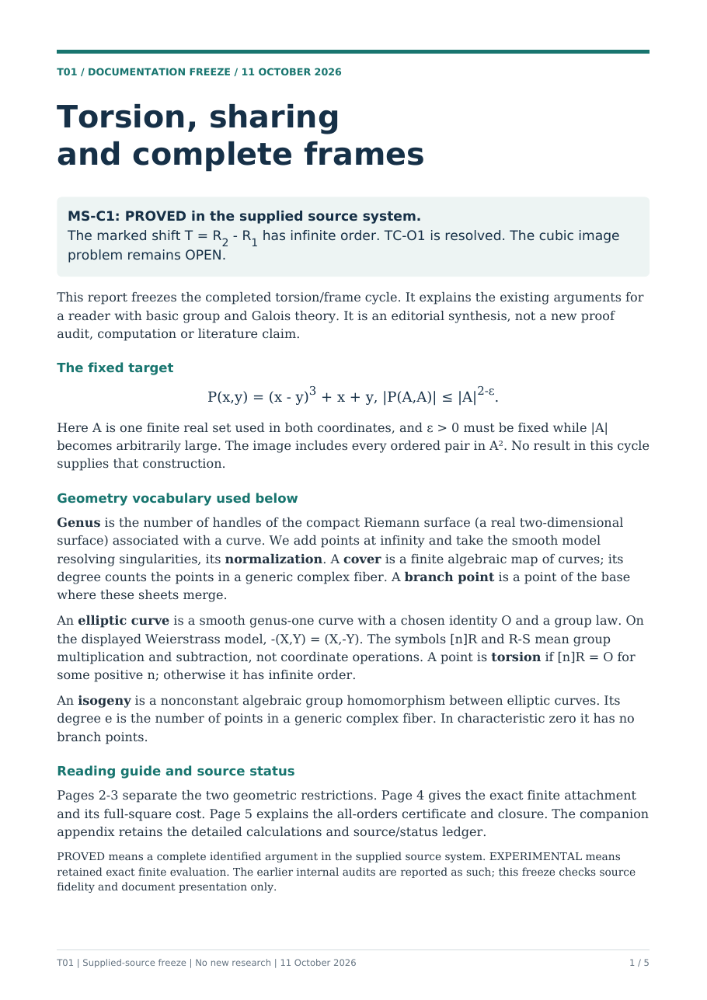

# T01 torsion/frame cycle: frozen professor-facing package

11 October 2026 · version 1 · documentation only, offline.

**MS-C1 is PROVED in the supplied source system:** the exact marked shift T=R2−R1 has infinite order. **TC-O1 is resolved.** The fixed cubic P(x,y)=(x-y)^3+x+y and its same-set real power-saving target remain **OPEN**.

## Deliverables

| Document | PDF | Editable Markdown |
| --- | --- | --- |
| Concise main report (5 pages) | [Main report](../../../output/pdf/2026-10-11-torsion-frame-freeze/main-report.pdf) | [Source](main-report.md) |
| Technical proof appendix and ledger (6 pages) | [Appendix](../../../output/pdf/2026-10-11-torsion-frame-freeze/technical-appendix.pdf) | [Source](technical-appendix.md) |
| One-page meeting summary | [Meeting summary](../../../output/pdf/2026-10-11-torsion-frame-freeze/meeting-summary.pdf) | [Source](meeting-summary.md) |

[Source/status ledger with exact source identities](source-status-ledger.md) · [Verification and preservation record](verification.md).

The main report defines the geometric and local-arithmetic terms before use, separates the fixed-output finite-locus theorem from the general one-row completion cover, and charges every pair of the six-scalar square. The appendix preserves the field, positive-root conventions, point coordinates, branch calculation and all-orders local certificate.

This freeze reports the existing proofs and prior internal audits; it is not a new proof audit. All required source companions were located. No prior proof, exact data file or program was modified or rerun. No new research obligation is adopted and no commit is made.
